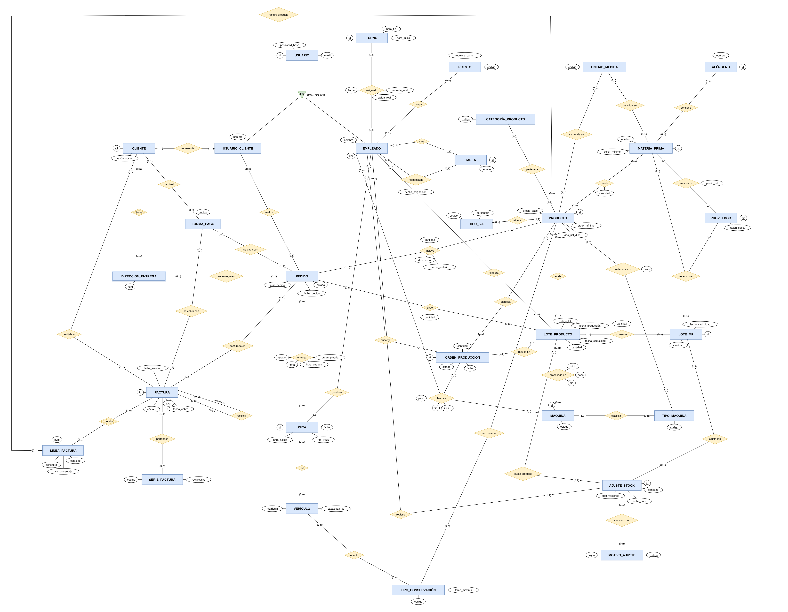

# Propuesta de TFG: ERP para una fábrica de congelados

## 1. Contexto

El proyecto es un **ERP a medida** para una empresa de manufactura de alimentación: un obrador que fabrica productos congelados (bollería, pan precocido, pastelería) a partir de materias primas compradas a proveedores, y los vende **a otras empresas** (hostelería, tiendas, cafeterías). Reparte con su propia flota.

Hoy este tipo de empresa suele trabajar con herramientas sueltas: una hoja de cálculo para el stock, papel para lo que se fabrica cada día, pedidos por teléfono o mensajería y un programa de facturación aparte. Eso provoca tres problemas:

- **La información se duplica y se contradice.** El stock de la hoja no coincide con el de la cámara, y el precio pactado con un cliente está en un correo y no en la factura.
- **La trazabilidad es difícil de demostrar.** El Reglamento (CE) 178/2002 obliga a saber, para cada lote fabricado, qué lotes de materia prima lleva y a qué clientes se entregó. Ante una alerta sanitaria, reconstruirlo con papeles lleva días.
- **Los clientes profesionales quieren pedir por internet**, viendo el catálogo con sus alérgenos (Reglamento (UE) 1169/2011).

Tres rasgos de esta empresa condicionan todo el diseño:

1. **Trabaja con congelados.** El producto dura meses, así que el riesgo principal no es que caduque, sino **quedarse sin existencias**. El sistema tiene que avisar de qué hay que fabricar antes de que se acabe.
2. **Sus máquinas no son programables.** Hornos, amasadoras y abatidores los manejan personas. El sistema no controla máquinas: genera un **horario de producción** que dice a cada empleado qué hacer, en qué máquina y a qué hora.
3. **Vende a empresas.** Un cliente es una sociedad con CIF, varios locales donde recibir y varias personas que piden. Cada venta termina en una factura legal.

## 2. Objetivos y alcance

**Objetivo general:** diseñar e implementar un ERP que centralice la información de la empresa en una única base de datos, garantice la **integridad y la trazabilidad** que exige la normativa alimentaria y de facturación, y sea **configurable** para que otra empresa del sector pueda usarlo sin tocar el código.

Sobre esa base de datos irían dos aplicaciones web:

- **Portal B2B para clientes:** catálogo con alérgenos, pedidos, seguimiento y consulta de facturas.
- **Aplicación interna para empleados**, por módulos:

| Módulo | Qué resuelve |
| --- | --- |
| Planificación | Qué hay que fabricar para no quedarse sin producto, y el horario de cada empleado y máquina |
| Producción | Qué se fabricó, cuándo, en qué máquinas, quién y con qué lotes de materia prima |
| Stock | Materia prima y producto terminado por lote, con caducidad, mermas y recuentos |
| Pedidos | Pedidos de clientes con precios pactados y estados |
| Reparto | Rutas diarias con repartidor, vehículo y orden de paradas, respetando la cadena de frío |
| Personal | Turnos y tareas |
| Facturación | Facturas legales con numeración sin huecos, rectificativas y PDF |

**Fuera del alcance** (trabajo futuro): contabilidad general y nóminas, envío de facturas a la AEAT (Verifactu), varias empresas en una misma instalación y varios almacenes.

## 3. Tecnologías

| Capa | Tecnología | Por qué |
| --- | --- | --- |
| Base de datos | PostgreSQL 17 | Relacional y libre. Permite poner las reglas de negocio en el propio motor (claves, restricciones, triggers, vistas), que es el núcleo del proyecto. |
| Entorno | Docker Compose y pgAdmin 4 | El entorno se levanta y se recrea desde cero con un comando. |
| Control de versiones | Git y GitHub | Historial y copia del código. |
| Backend | C# con .NET 8 (LTS), ASP.NET Core y Dapper | Una API REST sobre la base de datos. Dapper ejecuta SQL escrito a mano y convierte el resultado en objetos: encaja con un diseño en el que la lógica de datos vive en PostgreSQL (vistas y funciones) y no hace falta que un ORM genere las consultas. |

Además:

- **Frontend en React:** el portal B2B y la aplicación interna consumen la API.
- **Planificador como librería C# aparte:** la lógica de planificación (estimar la demanda, decidir qué fabricar, hacer el horario de los empleados y calcular las compras) va en una librería sin base de datos ni web. Se prueba sola y el backend la usa mediante inyección de dependencias. Los algoritmos intercambiables se modelan con el patrón Strategy.
- **Pruebas con xUnit:** cada algoritmo se comprueba con datos pequeños de resultado conocido.

Se elige una base de datos **relacional** porque los datos están muy conectados (un pedido toca a un cliente, una dirección, productos, lotes, una ruta y una factura) y su integridad es crítica. Una base documental obligaría a programar en la aplicación las relaciones y restricciones que aquí son precisamente el problema a resolver.

## 4. Diagrama entidad-relación

## 5. Entidades y por qué existen

### Personas y acceso

| Entidad | Qué representa | Por qué es una entidad |
| --- | --- | --- |
| USUARIO | Cualquiera que entra en el sistema | Un único login para todos, con email único y borrado lógico. |
| EMPLEADO | Un trabajador (subclase) | Tiene datos propios (DNI, puesto, carnet) y hace cosas que solo hace un empleado: elaborar, repartir, fichar. |
| USUARIO_CLIENTE | Una persona de una empresa cliente (subclase) | Separa *quién pide* (la persona) de *a quién se factura* (la empresa). |
| CLIENTE | La empresa compradora | Tiene CIF, domicilio fiscal y forma de pago pactada. |
| DIRECCIÓN_ENTREGA | Un local del cliente (débil) | Un cliente tiene varios locales; "la dirección 2 del cliente X" solo tiene sentido dentro de su cliente. |
| PUESTO, FORMA_PAGO | Catálogos | Listas que la empresa amplía sin tocar el esquema. |

### Catálogo y compras

| Entidad | Qué representa | Por qué es una entidad |
| --- | --- | --- |
| PRODUCTO | Lo que se fabrica y vende | Precio, vida útil, conservación y **stock mínimo**, que es lo que dispara la planificación. |
| MATERIA_PRIMA | Ingrediente o envase que se compra | Base de recetas, stock de entrada y alérgenos. |
| PROVEEDOR | A quién se compra | Origen de la cadena de trazabilidad. |
| ALÉRGENO | Los 14 de declaración obligatoria | Como entidad se puede preguntar con exactitud "¿qué productos llevan gluten?". Los del producto se deducen de su receta. |
| CATEGORÍA, UNIDAD_MEDIDA, TIPO_IVA, TIPO_CONSERVACIÓN | Catálogos | Configurables. TIPO_CONSERVACIÓN (congelado, refrigerado, ambiente) decide en qué vehículo puede viajar cada producto. |

### Stock y lotes

| Entidad | Qué representa | Por qué es una entidad |
| --- | --- | --- |
| LOTE_MP | Una entrada concreta de materia prima | El stock y la caducidad se controlan por lote, y es el punto de partida de la trazabilidad. |
| LOTE_PRODUCTO | Una tanda fabricada con su código de etiqueta | Une hacia atrás (qué lotes de MP lleva) y hacia delante (a qué clientes fue). |
| AJUSTE_STOCK | Una corrección: rotura, muestra, caducado, recuento | Lo que pasa fuera de producción y venta queda registrado con motivo, persona y fecha, en lugar de sobrescribir un número. Restricción: cada ajuste corrige un único lote, de MP o de producto (CHECK en la tabla). |
| MOTIVO_AJUSTE | Catálogo de motivos | Permite medir mermas por motivo. |

### Producción y planificación

| Entidad | Qué representa | Por qué es una entidad |
| --- | --- | --- |
| MÁQUINA | Un equipo concreto ("horno 1") | Saber por qué máquina pasó cada lote y no planificar en una averiada. |
| TIPO_MÁQUINA | Amasadora, horno, abatidor… | Define en qué tipo de máquina se hace cada paso del proceso de un producto. |
| ORDEN_PRODUCCIÓN | Lo que se decide fabricar ("400 croissants el martes") | Planificar antes de fabricar, con un estado que se sigue y enlazado al lote que salió. |

### Pedidos y reparto

| Entidad | Qué representa | Por qué es una entidad |
| --- | --- | --- |
| PEDIDO | Una compra de un cliente | Guarda lo pactado (precios, forma de pago) y sigue su estado. |
| VEHÍCULO | Furgoneta o camión | Qué puede transportar según su equipo de frío. |
| RUTA | Una salida de reparto | Repartidor, vehículo, horas y kilómetros una vez por salida, no en cada pedido. |

### Personal

| Entidad | Qué representa | Por qué es una entidad |
| --- | --- | --- |
| TURNO | Franja horaria (mañana, tarde, noche) | Plantilla que se repite; la planificación solo asigna trabajo dentro del turno de cada empleado. |
| TAREA | Un encargo que no es producción | Repartir trabajo y ver qué está pendiente. |

### Facturación

| Entidad | Qué representa | Por qué es una entidad |
| --- | --- | --- |
| FACTURA | Documento legal | Numeración propia, datos fiscales copiados e inmutable. |
| LÍNEA_FACTURA | Cada renglón (débil) | No existe fuera de su factura; el mismo producto puede aparecer en varias líneas y puede haber líneas sin producto (portes). |
| SERIE_FACTURA | Ordinaria o rectificativa | La ley exige series separadas para las rectificativas. |

## 6. Relaciones y por qué tienen esa cardinalidad

No se repiten aquí las 44: se explican las que deciden cómo funciona el sistema. Las demás son 1:N directas (un producto pertenece a una categoría, una máquina es de un tipo…).

### Las que sostienen la trazabilidad

| Relación | Entre | Cardinalidad | Por qué |
| --- | --- | --- | --- |
| recepciona | PROVEEDOR, MATERIA_PRIMA y LOTE_MP | Ternaria; cada lote es de una MP y un proveedor | Un lote de MP es de una materia prima y lo trajo un proveedor concreto. Hace falta saber los dos para retirar producto ante una alerta. |
| consume | LOTE_MP – LOTE_PRODUCTO | N:M con cantidad | Un lote fabricado usa varios lotes de MP (harina de dos sacos distintos) y un lote de MP alimenta varias tandas. Es el paso **hacia atrás** que exige la ley. |
| sirve | LOTE_PRODUCTO – PEDIDO | N:M con cantidad | Un pedido puede servirse con dos lotes y un lote se reparte entre muchos clientes. Es el paso **hacia delante**. |
| procesado en | LOTE_PRODUCTO – MÁQUINA | N:M con paso, inicio y fin | Un lote pasa por varias máquinas en orden. Si sale un lote defectuoso, se cruza con las averías. |
| elabora | EMPLEADO – LOTE_PRODUCTO | N:M | Quién participó en cada tanda. |

Con estas cinco se responde en una consulta a "este saco de harina estaba contaminado: ¿qué lotes lo llevan y a qué clientes fueron?".

### Las que modelan el proceso de fabricación

| Relación | Entre | Cardinalidad | Por qué |
| --- | --- | --- | --- |
| receta | PRODUCTO – MATERIA_PRIMA | N:M con cantidad | Qué lleva cada producto. De aquí salen sus alérgenos y su coste. |
| se fabrica con | PRODUCTO – TIPO_MÁQUINA | N:M con número de paso | El proceso de cada producto como una secuencia: paso 1 amasadora, paso 2 horno, paso 3 abatidor. Se apunta al *tipo*, no a una máquina concreta, para que valga cualquier horno libre. |
| plan paso | ORDEN_PRODUCCIÓN, MÁQUINA y EMPLEADO | Ternaria con paso, inicio y fin | El horario: "el paso 2 de la orden 17 lo hace Ana en el horno 1 de 8:00 a 9:30". Es ternaria porque los tres datos se deciden juntos y ninguno se deduce de los otros. |
| resulta en | ORDEN_PRODUCCIÓN – LOTE_PRODUCTO | 1:1, opcional en la orden | Cuando la orden se termina, queda unida al lote que salió. Así se compara lo planificado con lo real. |

### Las que modelan la venta

| Relación | Entre | Cardinalidad | Por qué |
| --- | --- | --- | --- |
| realiza | USUARIO_CLIENTE – PEDIDO | 1:N | Se sabe qué persona hizo cada pedido. |
| se entrega en | DIRECCIÓN_ENTREGA – PEDIDO | 1:N | Cada pedido va a un local; el sistema obliga a que sea un local *de su propio cliente*. |
| incluye | PEDIDO – PRODUCTO | N:M con cantidad y precio | El precio se copia en el momento del pedido, para que un cambio de tarifa no altere pedidos pasados. |
| entrega | PEDIDO – RUTA | N:M con orden de parada y resultado | Normalmente 1:1, pero si el cliente no está, el pedido sale en otra ruta. Se guardan todos los intentos y solo uno puede tener éxito. |
| admite | VEHÍCULO – TIPO_CONSERVACIÓN | N:M | Una furgoneta con equipo de frío admite congelado y refrigerado; otra solo ambiente. Un congelado no puede salir en un vehículo que no lo admita. |
| facturado en | PEDIDO – FACTURA | 1:N, opcional en el pedido | Una factura puede agrupar los pedidos de un mes, pero un pedido se factura **como mucho una vez**. |

### Casos especiales de notación

| Caso | Dónde | Por qué |
| --- | --- | --- |
| Generalización | USUARIO → EMPLEADO, USUARIO_CLIENTE | Comparten el acceso (email, contraseña, activo), pero cada uno tiene datos y relaciones propias. Total y disjunta. |
| Entidad débil | DIRECCIÓN_ENTREGA (de CLIENTE), LÍNEA_FACTURA (de FACTURA) | Se identifican por su propietaria más un número: "línea 3 de la factura F-2026-143". |
| Reflexiva | rectifica (FACTURA – FACTURA) | Una factura con un error no se edita: se emite otra que la corrige y apunta a ella. |
| Restricción con CHECK | ajusta MP / ajusta producto | Un ajuste corrige exactamente un lote, de MP o de producto. En el diagrama son dos relaciones (0,1) normales; la regla de que solo puede darse una no se dibuja, se implementa con un CHECK que obliga a rellenar exactamente una de las dos claves foráneas. Se eligió frente a dos entidades de ajuste separadas porque comparten todos sus atributos (motivo, empleado, fecha, cantidad). |

## 7. Tablas que salen del modelo

El paso a relacional sigue las reglas habituales:

- Cada **entidad** es una tabla.
- Cada relación **1:N** es una clave foránea en el lado N (no genera tabla).
- Cada relación **N:M** o **ternaria** es una tabla propia, con las claves de las entidades que une y sus atributos.
- La **generalización** se resuelve con una tabla por clase: EMPLEADO y USUARIO_CLIENTE usan como clave la de USUARIO.
- Las **entidades débiles** llevan como clave la de su propietaria más un número.

El resultado son **45 tablas** (las claves primarias van entre paréntesis):

| Bloque | Tablas de entidad | Tablas de relación N:M o ternaria | Catálogos |
| --- | --- | --- | --- |
| Personas | usuario (id), empleado (usuario_id), usuario_cliente (usuario_id), cliente (id), direccion_entrega (cliente_id, num) | — | puesto, forma_pago |
| Catálogo y compras | producto (id), materia_prima (id), proveedor (id), alergeno (id) | receta (producto_id, materia_prima_id), proveedor_materia_prima (proveedor_id, materia_prima_id), materia_prima_alergeno (materia_prima_id, alergeno_id) | categoria_producto, unidad_medida, tipo_iva, tipo_conservacion |
| Stock y lotes | lote_mp (id), lote_producto (codigo_lote), ajuste_stock (id) | consumo (codigo_lote, lote_mp_id) | motivo_ajuste |
| Producción | maquina (id), orden_produccion (id) | producto_tipo_maquina (producto_id, paso, tipo_maquina), procesado_en (codigo_lote, paso), elabora (codigo_lote, empleado_id), plan_paso (orden_id, paso) | tipo_maquina |
| Pedidos y reparto | pedido (num_pedido), vehiculo (matricula), ruta (id) | linea_pedido (num_pedido, producto_id), servicio_lote (num_pedido, codigo_lote), entrega (ruta_id, num_pedido), vehiculo_conservacion (vehiculo, conservacion) | — |
| Personal | turno (id), tarea (id) | asignacion_turno (empleado_id, fecha, turno_id) | — |
| Facturación | factura (id), linea_factura (factura_id, num), empresa (id) | factura_pedido (num_pedido) | serie_factura |

Dos detalles del paso a tablas que merece la pena señalar:

- **factura_pedido** tiene como clave solo `num_pedido`, no la pareja. Eso es lo que garantiza en el propio esquema que un pedido no se factura dos veces.
- **empresa** es una tabla de una sola fila con los datos fiscales del emisor. No aparece en el diagrama como entidad relacionada porque sus datos se *copian* en cada factura, no se referencian (ver decisión D5).

## 8. Decisiones de diseño principales

**1. Configurable, dirigido por datos.** Máquinas, recetas, productos y empleados son *filas*, no tablas ni columnas. Las listas que podrían ir fijas en el código (puestos, formas de pago, tipos de máquina, tipos de IVA) son tablas de catálogo que la empresa amplía desde la aplicación. Se descartaron un modelo multiempresa (demasiado coste para una necesidad que no existe hoy) y el modelo genérico entidad-atributo-valor, porque pierde los tipos y las claves foráneas, que son justo las garantías que se buscan.

**2. El stock se calcula, no se guarda.** Una columna "stock" que se sobrescribe pierde la historia y acaba descuadrándose. El stock de cada lote se obtiene de sus movimientos: lo recibido o fabricado, menos lo consumido o servido, más los ajustes. Así nunca contradice a los datos que lo originan.

**3. Las correcciones son movimientos, no ediciones.** Si se rompe una caja, no se cambia el número: se registra un ajuste con motivo, empleado y fecha. Es el mismo principio que el contraasiento en contabilidad, y da a la vez auditoría, indicadores de mermas y el registro que pide el plan de autocontrol sanitario (APPCC).

**4. Las reglas de negocio viven en la base de datos.** Todo lo que puede expresarse con claves, `UNIQUE`, `NOT NULL` o `CHECK` va en el esquema, y lo que necesita mirar otras tablas (que no se sirva más de lo que hay, que un pedido vaya a una dirección de su cliente, que una máquina no esté en dos sitios a la vez) va en triggers y restricciones de PostgreSQL. Así la integridad no depende de que la aplicación esté bien programada.

**5. Lo pactado se copia.** El precio de cada línea de pedido, la forma de pago del pedido y todos los datos de la factura (cliente, emisor, conceptos, IVA aplicado) se copian en el momento. Si mañana cambia el catálogo o sube el IVA, los documentos pasados siguen diciendo lo mismo. La factura, además, es inmutable: un error se corrige con una rectificativa.

**6. Lo planificado y lo realizado van por separado.** La orden de producción y su horario son una previsión que se cambia muchas veces; lo que pasó de verdad (en qué máquina, quién, con qué lotes) es un registro de trazabilidad que no debe cambiar. Separarlos permite además comparar el plan con la realidad.

**7. Borrado lógico.** Clientes, productos, proveedores o usuarios no se borran: se desactivan. No se puede borrar algo que tiene historia (un cliente con pedidos, una materia prima usada en lotes).

## 9. Siguientes pasos y dudas

**Plan de trabajo:**

1. Cerrar el modelo entidad-relación con las observaciones del tutor.
2. Implementar la base de datos en PostgreSQL con sus restricciones, vistas y funciones, y unas pruebas que demuestren que las reglas se cumplen.
3. Desarrollar el backend (API) sobre la base de datos.
4. Desarrollar el portal B2B y la aplicación interna.
5. Desplegar todo con Docker y redactar la memoria.

**Ampliaciones que se están valorando:** un apartado de métricas (escandallos, margen por producto, coste de las mermas), el fichaje y firma de horas por parte de los empleados, y hojas de producción diarias rellenadas desde la aplicación.

**Dudas sobre las que me gustaría su opinión:**

- ¿El alcance es adecuado para un TFG, o conviene recortar algún módulo?
- ¿Le parece bien poner tantas reglas de negocio en la base de datos, o prefiere que la memoria las justifique en el backend?
- ¿La notación Chen es la adecuada para la memoria, debería añadir otra como pata de gallo o UML?
